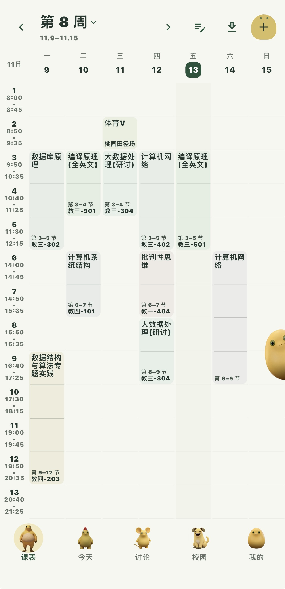
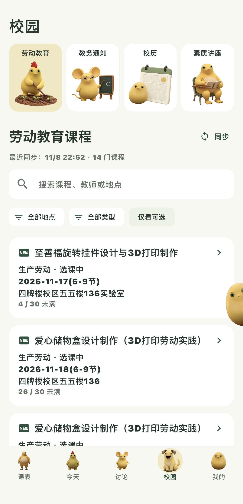
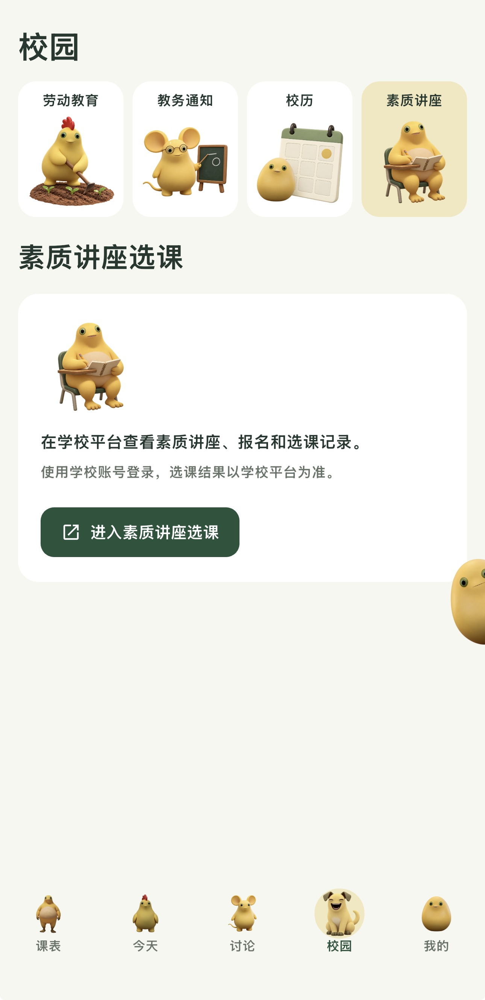

<div align="center">
  
  <h1>梅课 MeiKe</h1>
  <p><strong>好好上课，不必等候。</strong></p>
  <p>为东南大学同学打造的课表与校园信息工具</p>
  <p>
    <a href="https://106.14.199.134/">访问官网</a> ·
    <a href="https://everflora.github.io/MeiKe-site/">GitHub Pages</a> ·
    <a href="https://github.com/Everflora/MeiKe-site/releases/tag/android-v1.6.5">Android 下载</a> ·
    <a href="https://everflora.github.io/MeiKe-web/">iPhone 网页版</a>
  </p>
</div>

## 一周课程，校园动态

| 整周课表 | 劳动教育 | 素质讲座 |
| :---: | :---: | :---: |
|  |  |  |

梅课将整周课程、教务通知、劳动教育、素质讲座和校历放在手边。官网提供「青梅」「银杏」「奶家日常」三套主题的交互预览，主题切换作用于示意卡片。上方为实机截图，可在官网点击查看大图。

## 开始使用

| 平台 | 使用方式 |
| --- | --- |
| **Android** | 从 [GitHub Release](https://github.com/Everflora/MeiKe-site/releases/tag/android-v1.6.5) 下载 APK。当前版本为 **1.6.5（构建 25）**，支持 Android 7.0 及以上。 |
| **iPhone** | 用 Safari 打开 [梅课网页版](https://everflora.github.io/MeiKe-web/)，通过「分享 → 添加到主屏幕」创建入口。参见 [Apple 使用指南](https://support.apple.com/zh-cn/guide/iphone/iphea86e5236/ios)。 |

部分校园功能需要学校账号，功能入口随平台而异。换设备前，可使用应用内的课表导出功能备份数据。

<details>
<summary>校验 Android 安装包</summary>

安装包大小为 24,256,309 字节（约 23.1 MiB）。SHA-256：

```text
392a89e9f88763ac7a36f1c0e56f645ce2d4365dad3c0dddbe6bca1f233bb058
```

</details>

## 本地预览与发布

本仓库维护公开宣传站，Flutter 主工程与网页应用分别维护。站点使用 HTML、CSS 和 JavaScript，支持移动端布局和系统「减少动态效果」偏好，无需安装前端依赖或构建。

在仓库根目录运行以下命令，然后打开 [本地预览](http://127.0.0.1:8843/)。

```sh
python3 -m http.server 8843 --bind 127.0.0.1
```

- **部署官网**：将 `index.html`、`style.css`、`app.js`、`config.js` 和 `assets/` 放入静态站点目录。GitHub Pages 使用 `main` 分支根目录作为发布源。
- **更新下载入口**：在 [`config.js`](./config.js) 中配置 `webAppUrl`，并同步 Android 的 `url`、`version`、`size` 和可选的 `releaseNotesUrl`。Android 地址为空时，下载按钮会禁用。
- **发布安装包**：在真机验证 APK 后，将其上传到 GitHub Release，同步更新下载配置和上面的校验信息。官网素材沿用梅课主题资源，新增素材发布前由团队确认使用范围。
